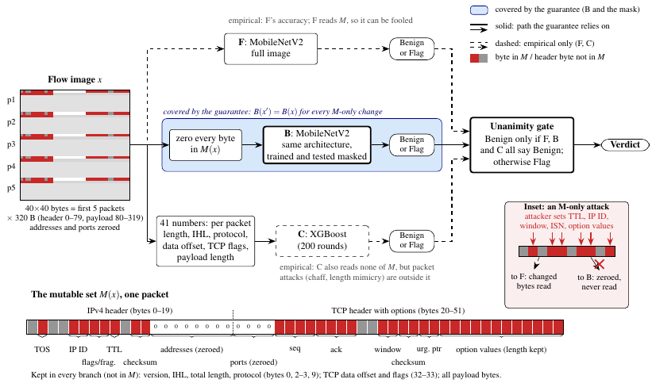
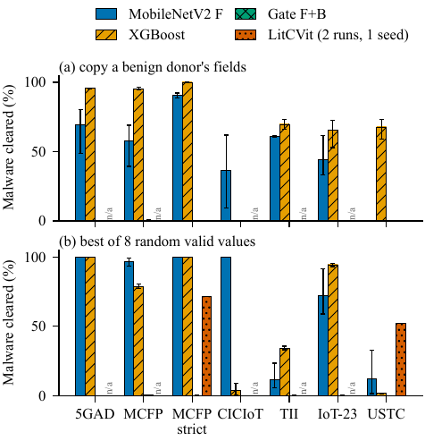
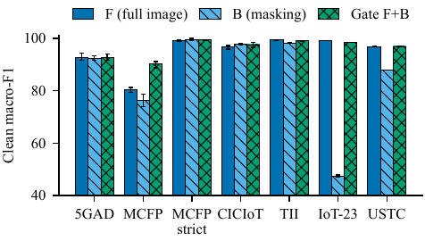
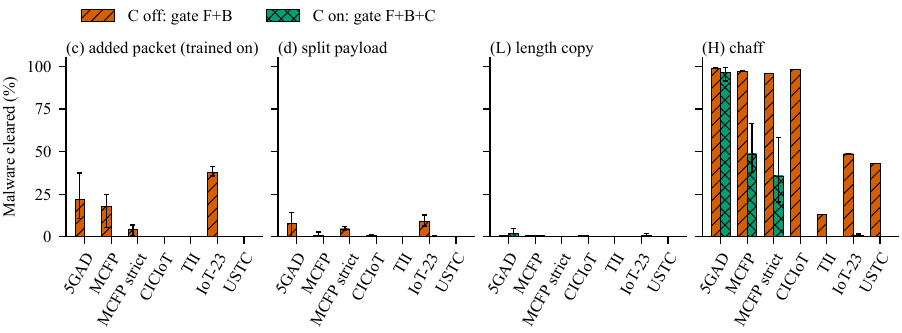

<div align="center">

# 🛡️ BAG — Bounded-Acquittal Gate

### *Headers may convict, never acquit.*

**Bounding Acquittals of Forged-Header Malware in Raw-Byte Traffic Detectors**

Deetya Ashish Mehta · Sudarshan Sudhakar · Dr. Pradeepkumar Bhale
<br>
<sub>Dept. of Computer Science and Engineering, IIITDM, Chennai</sub>

[](paper/BAG_paper.pdf)
[](#-reproducing)
[](#-reproducing)
[](#-reproducing)
[](#)

</div>

---

## 💡 TL;DR

Raw-byte malware-traffic detectors such as **LitCVit** reach near-perfect accuracy, but much of it comes from **IP/TCP header fields** like TTL, IP ID, TCP window and sequence numbers. **The sender sets those fields, and in malware traffic the sender is the attacker.**

- 🔓 **The attack.** Forge only those fields, with checksums recomputed and payload and lengths unchanged. A byte-image detector then calls **≥ 59 %** of the malware it used to catch *benign* on 6 of 7 runs. Our LitCVit rebuild lets **52–71 %** through. Forged packets pass three validators, and **250 / 250** forged handshakes complete against an unmodified Linux stack.
- 🛡️ **The defence: BAG.** Keep the full detector, but only clear a flow if a second model that **never sees the forgeable fields** agrees. Under any header-only attack, attack success is **at most the blind model's own miss rate**. We check this byte by byte on **649,966** attacked flows, with zero violations.
- 📊 **The cost.** BAG stays within **0.72 macro-F1 points** of the full model, recovers **9–51 points** over plain masking where masking loses accuracy, and costs up to **3.86 points** of benign recall.
- ⚠️ **The honest limit.** Chaff (added packets) still evades the gate on 3 of 7 runs.

---

## 🧭 How BAG works

<p align="center">
  
</p>

| Member | Model | Sees | Role |
|:--:|---|---|---|
| **F** | MobileNetV2 | the full 40×40 flow image | accuracy |
| **B** | MobileNetV2 | the image with every byte in **M** zeroed | the **guarantee**: forging M can't move B |
| **C** | XGBoost | 41 per-flow numbers (lengths, flags, header sizes) | empirical guard against packet-level attacks |

> **Unanimity rule:** a flow is **Benign** only if F, B *and* C all say Benign. Any one of them can convict. The header alone can never acquit.

**M**, the set of sender-controlled fields, is justified field by field from the RFCs in [`sprint3/GUARANTEE.md`](sprint3/GUARANTEE.md). It covers IP TOS, ID, DF and TTL, TCP seq/ack, window, urgent pointer and option values, the checksums, the IPv6 traffic class, flow label and hop limit, and the UDP/ICMP checksums.

---

## 📈 Results at a glance

<p align="center">
  
</p>

<p align="center"><sub><b>Header-attack success.</b> Undefended detectors are cleared en masse. The gate (F+B) stays at its bound.</sub></p>

<table>
<tr>
<td></td>
<td></td>
</tr>
<tr>
<td align="center"><sub>Clean macro-F1: the gate keeps F's accuracy</sub></td>
<td align="center"><sub>Packet attacks with C off and on</sub></td>
</tr>
</table>

Evaluated on **6 datasets / 7 runs**: USTC-TFC2016, CICIoT2022, 5GAD-2022, MCFP (+ strict), IoT-23 and TII-SSRC-23.

---

## 🔍 Along the way: findings about the benchmarks

This project began as an independent re-check of LitCVit. Those results are the paper's motivation:

- 🎯 **Headers alone are enough.** Header bytes alone give ≥ 92 % macro-F1 on every dataset. On USTC-TFC2016 the single rule *"first-packet TTL = 32 ⇒ benign"* scores **100.00 %**.
- 🔐 **"Encrypted" ≠ encrypted.** 96.8 % of the payload bytes in "encrypted" TLS attack flows are plaintext. Every Dridex and Shifu TLS flow ends at the ClientHello.
- 🧪 **Splits flatter models.** A time-based split drops CICIoT2022 from 99.6 to 57.2 macro-F1. Holding out benign hosts collapses benign recall on four runs, because the models memorise hosts.
- 🪶 **Pretraining isn't needed.** A plain MobileNetV2 at 13 M multiply-adds per flow nearly matches LitCVit (123–263 M).

---

## 🗂️ Repository layout

```
📦 BAG
├── 📄 paper/              LaTeX source, tables, figures and the final PDF (BAG_paper.pdf)
├── 🧪 sprint3/            the BAG method: pre-registration, guarantee, experiments E1–E9, report
│   ├── code/              experiment scripts (forging, live handshakes, packet attacks, group split…)
│   └── results/           raw CSV/JSON behind every number in the paper
├── 🏃 sprint/             sprint 2: baselines, training, the length-view model, verdicts
├── ☁️ kaggle/             GPU jobs: LitCVit rebuild, evasion, gate, losses, model benchmark
├── 🔧 prep/               pcap → 40×40 flow-image pipeline (byte-identical to YaTC's data)
├── 📏 baselines/          header-vs-payload baselines
├── 📊 results/            phase-1 re-check results
└── 📝 OVERVIEW.md         the whole project in plain language
```

Every claim in the paper maps to a numbered entry in the claim ledger in [`sprint3/REPORT.md`](sprint3/REPORT.md). [`paper/check_ledger.py`](paper/check_ledger.py) checks the paper against it.

---

## 🚀 Reproducing

```bash
# 1. Build flow images from raw pcaps (5 packets × 320 B, addresses and ports zeroed)
python prep/pcap_to_flows.py --help

# 2. Run the BAG experiments, E1–E9 (sprint3/code/queue*.sh list the exact order)
python sprint3/code/e124.py   # invariance, bound check, bootstrap
python sprint3/code/e5_forge.py # forging + validators

# 3. Rebuild the paper tables and figures from the saved results
python paper/make_paper_tables.py
python paper/figs/scripts/<figure>.py
```

GPU-heavy jobs (the LitCVit rebuild, the benchmark and the seeds) live under [`kaggle/`](kaggle/) and run as Kaggle notebooks. [`kaggle/colab/run_on_colab.ipynb`](kaggle/colab/run_on_colab.ipynb) is a Colab alternative.

> **Note.** The datasets are public but not redistributed here. See [`datasets.md`](datasets.md) for sources.

---

## 📚 Citation

```bibtex
@misc{mehta2026bag,
  title  = {{BAG}: Bounding Acquittals of Forged-Header Malware in Raw-Byte Traffic Detectors},
  author = {Mehta, Deetya Ashish and Sudhakar, Sudarshan and Bhale, Pradeepkumar},
  year   = {2026},
  note   = {Computer Network Security course project, IIITDM Chennai}
}
```

<div align="center">
<sub>Made with ☕ and a lot of forged packets.</sub>
</div>
